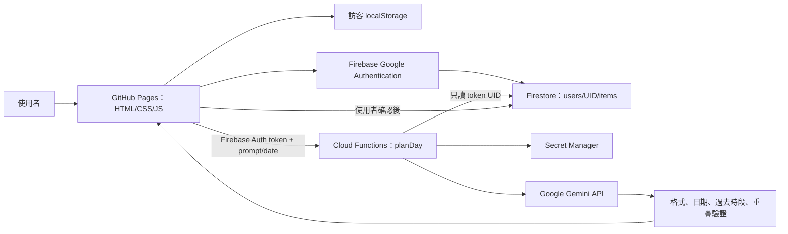

# 系統設計與需求分析

## 問題與目標

學生的行程、課堂作業與個人待辦分散，容易忘記期限或重複安排時間。目標是以少量必填欄位記錄事項，在單一畫面確認當天安排，並利用 AI 協助找時段。AI 建議由使用者決定是否採用。

## 使用者與範圍

- 訪客：使用獨立本機空間，不需帳號。
- Google 登入者：使用自己的 Firestore 資料及 Gemini 後端。
- 不在目前範圍：LINE、多人共用、跨日／週期事件、背景通知、Google Calendar 串接、醫療或其他專業建議。

## Use cases

| 編號 | 目標 | 主要步驟 | 例外 |
| --- | --- | --- | --- |
| UC01 | 建立行程 | 選日期 → 輸入標題及時段 → 儲存 | 必填或時間錯誤保留內容；重疊提醒但允許保留 |
| UC02 | 管理任務 | 新增 → 設到期日／重要性 → 勾選完成 | 可取消完成；逾期保留並提示 |
| UC03 | 登入及同步 | 點 Google → 授權 → 讀取 UID 空間 | 取消／阻擋／網路失敗顯示提示；不自動匯入本機內容 |
| UC04 | AI 輔助規劃 | 選日期 → 提需求 → 伺服器讀自己的資料 → Gemini → 驗證建議 → 手動確認 | 未登入走本機規則；API 失敗不假裝成功；儲存前再檢查衝突 |
| UC05 | 備份與還原 | 匯出 JSON；選備份 → 整份驗證 → 確認合併 | 2 MB／400筆限制、重複／無效 ID 拒絕；同 ID 更新 |
| UC06 | 登出 | 停止舊帳號訂閱 → 清除雲端畫面及對話 → 載入本機 | 舊的非同步回覆被 generation 標記丟棄 |

## 架構

## 資料

每筆資料位於 `/users/{uid}/items/{id}`。

| 欄位 | 規則 |
| --- | --- |
| id | 隨機 UUID；備份匯入只接受 1–100 位英數、底線、連字號 |
| kind | event 或 task |
| title | 必填，trim 後 1–100 字 |
| date | YYYY-MM-DD，瀏覽器驗證實際日期 |
| category | study／work／life／personal |
| notes | 0–1000 字 |
| completed、demo | 布林值 |
| updatedAt | 儲存當下毫秒數 |
| start、end、location | 僅 event；24 小時制；end > start；地點最多120字 |
| priority | 僅 task；high／medium／low |

Firestore Rules 驗證擁有者、欄位白名單、資料型別、日期格式及時段規則；瀏覽器和後端共用 `src/core.js` 的實際日曆驗證。AI 用量放在 `/aiUsage/{uid}/days/{Asia-Taipei日期}`，只可由 Admin SDK 存取。

## 行程重疊規則

同一天、兩筆未完成事件，當 `A.start < B.end` 且 `A.end > B.start` 才視為重疊。首尾相接允許。編輯忽略自己的 ID。跨日事件必須拆成兩筆。AI 只提當天未來時段，且不得與現有事件或同一回覆中的其他建議重疊。

## 同步及錯誤處理

Google 登入後等第一份 Firestore snapshot 再開放修改；寫入等待伺服器 batch commit。失敗不顯示已儲存。本機寫入先確認 localStorage 成功，再更新畫面。雲端空間不自動保存到本機。登出清掉舊帳號畫面與 AI 建議，再載入獨立的本機空間。

## 已知限制

本機規劃只使用規則及少量關鍵字，不能解析自由文字的日期或自然語言時間限制。雲端 AI 會收到最小化的行程／待辦內容，需要已登入及完成部署。沒有背景通知與多人協作；不提供 LINE 登入。規則與程式測試不能替代正式授權、Firestore 規則與跨裝置實測。
